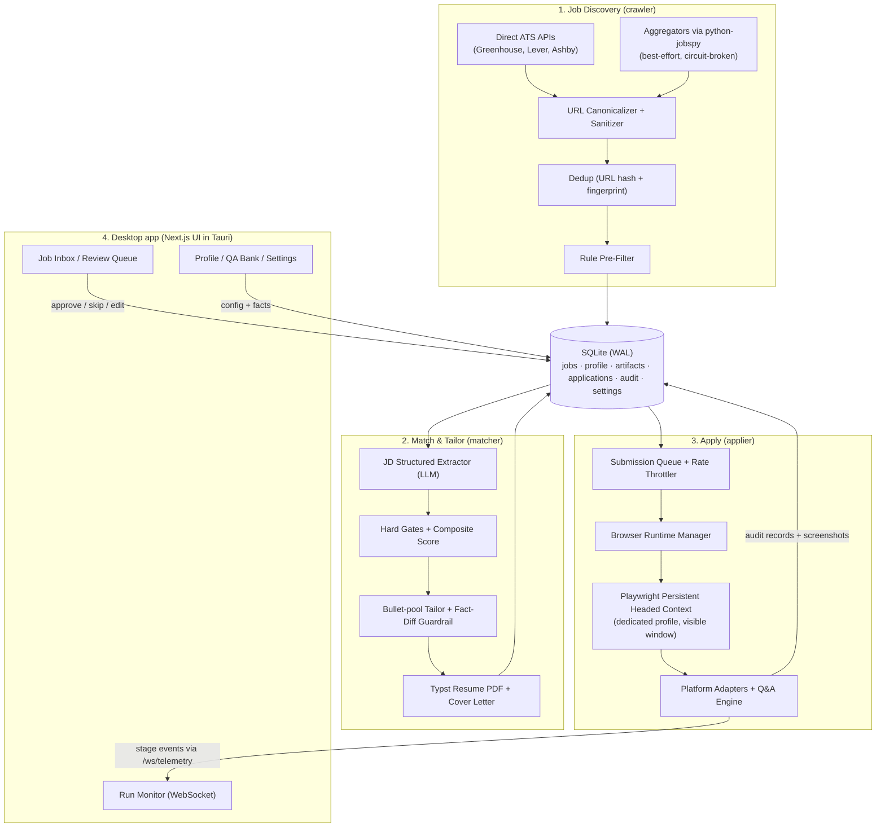
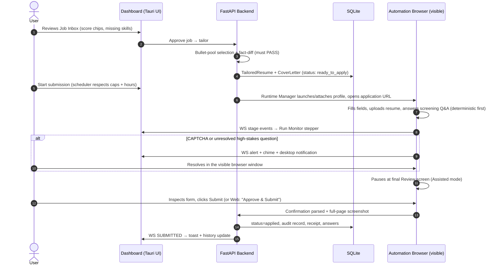
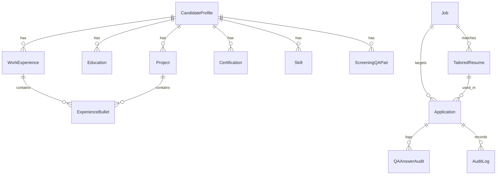
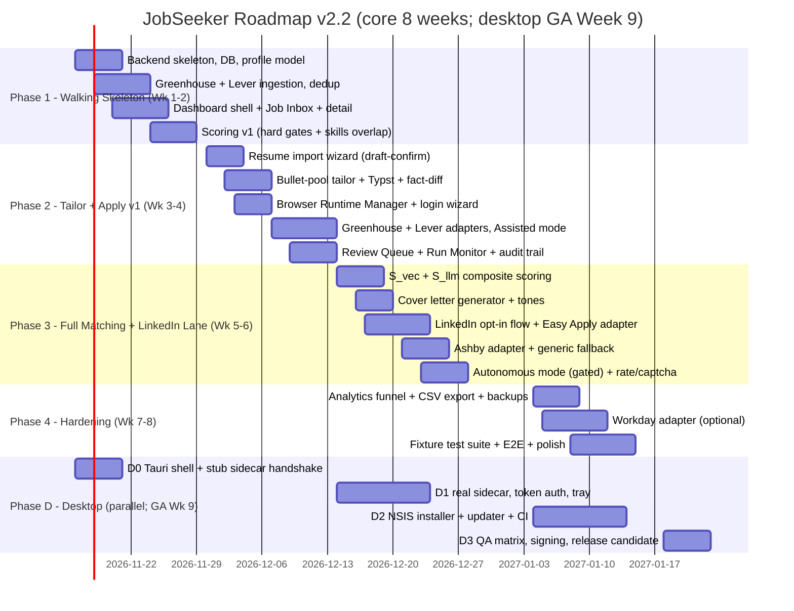

# JobSeeker: Desktop System Architecture & Master Implementation Blueprint

**Document Version:** 2.2.0 (Tauri 2 desktop revision)
**Author:** Lead Systems Architect
**Status:** Finalized — incorporates all findings from `docs/PLAN_REVIEW.md`; v2.1 updates the frontend stack and execution model
**Sub-docs:** `docs/JOB_DISCOVERY_ENGINE_DESIGN.md`, `docs/ATS_MATCHING_AND_TAILORING_SPEC.md`, `docs/form_automation_engine_design.md`, `docs/FRONTEND_DASHBOARD_DESIGN.md`, `docs/SAFETY_AND_RISK_AUDIT_REPORT.md`
**Implementation specs:** `docs/FINAL_EXECUTION_PLAN.md` (authoritative execution plan — ownership, schedule, decisions), `docs/BACKEND_IMPLEMENTATION_SPEC.md` (backend — frozen API contract §7–8), `docs/FRONTEND_DASHBOARD_DESIGN.md` (Next.js frontend)

---

## 0. What Changed (Changelog)

| Change | Reason |
| :--- | :--- |
| **Chrome extension and in-page HUD removed.** *[v2.1 superseded the "no desktop packaging" part: v2.2 ships a Tauri 2 shell.]* | The dashboard is the only interface. Final review happens in the visible automation browser window + the Run Monitor. Less surface area, fewer moving parts. |
| **"Attach Playwright to the user's real Chrome via CDP" removed.** | Chrome ≥136 ignores `--remote-debugging-port` on the default user-data directory (security change, May 2025). Replaced with a **dedicated, app-managed automation browser profile** (real Chrome, visible window, one-time logins). See §4.4 Browser Runtime Manager. |
| **MVP-first roadmap.** End-to-end value at Week 4, hardening after. | v1 front-loaded 6 weeks of build before the user got anything. |
| **Honest ToS framing.** LinkedIn is an explicit, typed, opt-in risk lane — never labeled "compliant". | Automation violates LinkedIn's User Agreement regardless of stealth; the plan must say so. |
| **All contracts unified.** One job-status vocabulary, one audit store, one autonomous-mode gate (≥95%, non-LinkedIn ATS, 100% deterministic Q&A, explicit opt-in). | v1 docs contradicted each other in 8 places. |
| **New sections:** LLM cost model & routing, secrets/key management, testing strategy, DB backup. | Were missing entirely. |
| **Fabricated "verified" claims removed** (e.g., "ATS parse score 100/100, verified against Workday parsers"). | Nothing had been verified; no code existed. Verification is now a defined test, not an assertion. |

### v2.1 changes (2026-11-11)

| Change | Reason |
| :--- | :--- |
| **Frontend is Next.js (App Router).** *[Superseded in v2.2: builds as a static export loaded by the Tauri shell; detail routes are query-based.]* | Framework chosen for routing, layouts, and typed routes against FastAPI's OpenAPI. |
| **Two-agent build with a frozen contract and review gates.** Gemini Antigravity owns `backend/`; OpenCode owns `frontend/` and acts as integration lead/reviewer. | Clear ownership prevents merge conflicts and contract drift; the plan now has an explicit operating protocol (`docs/FINAL_EXECUTION_PLAN.md` §9). |
| **Schema v2.1:** added `education`, `projects`, `certifications`, `resume_import_drafts`; added `jobs.company_logo_url`, `tailored_resumes.cover_letter_tone`; `experience_bullets.project_id` is now a real FK. | The DDL was missing entities the profile model and API already depended on. |
| **Doc consistency pass:** removed stealth/proxy rotation, removed "factual rephrasing," aligned frontend endpoint names and the application status enum. | v2 claimed unified contracts but eight smaller drifts remained; the Decisions Log in `docs/FINAL_EXECUTION_PLAN.md` §10 now resolves them. |

### v2.2 changes (2026-11-11)

| Change | Reason |
| :--- | :--- |
| **Ships as a Windows desktop app: Tauri 2 shell + WebView2.** | Removes hosting/terminal friction; the app is inherently local (SQLite, keyring, Chrome, human-in-the-loop). The shell owns the window and lifecycle; the sidecar owns all business logic. |
| **Backend becomes a PyInstaller sidecar on an OS-assigned port with a per-launch bearer token.** | No Python install for the user; port 0 avoids conflicts; token + Host check stop other local processes and DNS rebinding. |
| **Next.js builds as a static export; detail routes become query-based (`/jobs?id=`, `/runs?id=`).** | Static export cannot generate runtime UUID paths. Decided at F0 to avoid a later refactor. |
| **Production release pipeline: NSIS installer, signed updates, pre-migration backups, QA matrix.** | "Production grade" means crash recovery, verifiable updates, and safe uninstall — not just an .exe wrapper. Full spec: `docs/DESKTOP_PACKAGING_SPEC.md`. |
| **Desktop is a parallel phase (D0–D3), not a rewrite.** Core web build still reaches G4 at Week 8; desktop GA is Week 9. | Protects the MVP timeline while delivering the desktop product. |

---

## 1. Executive Summary & System Vision

**JobSeeker** / **JobSeeker** is a personal job-application **desktop app** that runs locally on the candidate's machine. It finds jobs, scores them against the candidate's verified profile, generates truthful tailored resumes and cover letters, fills application forms in a **visible automation browser**, and pauses for a human final check before anything is submitted. It is a precision copilot — not a spray-and-pray bot.

### Core Value Propositions
1. **Tiered Job Discovery**: ingests directly from public ATS board APIs (Greenhouse, Lever, Ashby — structured JSON, no detection risk) with best-effort aggregator sweeps (LinkedIn, Indeed via `python-jobspy`) behind circuit breakers.
2. **Zero-Fabrication Tailoring**: resumes are assembled by **selecting and reordering verified bullet points** from the candidate's master profile; numerical metrics are immutable constants; a deterministic fact-diff rejects any unearned claim. Cover letters are derived the same way.
3. **Visible Dedicated Automation Browser**: the applier runs a real, headed Chrome window under an app-managed profile the user logs into once per platform. The user can watch every keystroke. No stealth arms race, no extension.
4. **Human-in-the-Loop by Default**: every application halts at the final review screen. The user glances at the filled form and clicks Submit (or triggers it from the dashboard). Full audit trail with screenshots.
5. **Honest Risk Lanes**: career-site applications (Greenhouse/Lever/Ashby) are the safe default lane. LinkedIn Easy Apply is opt-in only, after a typed risk acknowledgment, with hard daily caps. CAPTCHAs are never bypassed — automation freezes and asks the human.

---

## 2. System Architecture

Five components, one machine: **Tauri 2 desktop shell** (native window, tray, updater) hosting the **Next.js dashboard** + **FastAPI sidecar** (crawler, matcher, tailor, applier) + **SQLite database** + **automation browser** (Playwright-driven Chrome window).



### End-to-End Sequence



---

## 3. Technology Stack

| Subsystem | Choice | Alternatives | Rationale |
| :--- | :--- | :--- | :--- |
| **Backend** | Python 3.12 + FastAPI | Node/NestJS, Go | First-class `curl_cffi`, `python-jobspy`, Playwright async, Pydantic v2, LiteLLM. Auto OpenAPI → generated TS types for the frontend (zero contract drift). |
| **Database** | SQLite (WAL) via SQLAlchemy 2.0 + Alembic | PostgreSQL, MongoDB | Zero-setup local deployment. Dialect-agnostic ORM keeps a later Postgres migration open. PRAGMAs are applied at connection init, kept out of the portable DDL. |
| **Vector store** | sqlite-vec | Chroma, Pinecone | Local, private, zero extra processes. Embeddings are only used for match scoring — modest scale. |
| **Frontend** | **Next.js (App Router) + React 19 + TS + Tailwind + shadcn/ui**, TanStack Query, Zustand | Vite SPA, Streamlit | Static export (`output: 'export'`) loaded by the Tauri shell. Detail routes are query-based (`/jobs?id=`, `/runs?id=`) because runtime UUID paths cannot be statically generated. Full design in `docs/FRONTEND_DASHBOARD_DESIGN.md`. |
| **Desktop shell** | **Tauri 2 (Rust) + WebView2** | Electron, PyWebView, plain installer | Native window, tray, signed auto-updater, notifications, sidecar supervisor, single-instance guard, NSIS per-user installer. ~10 MB shell; no duplicated Chromium. Full spec: `docs/DESKTOP_PACKAGING_SPEC.md`. |
| **Automation** | Playwright **persistent headed context**, dedicated `--user-data-dir` under app data | CDP-attach to user Chrome; MV3 extension; headless | Chrome ≥136 blocks CDP on the default profile, so attach-to-daily-Chrome is dead. A dedicated profile is a real Chrome with real fingerprint/IP; the user logs in once per platform; the window is **visible** so HITL review happens right in the page. Headless is rejected: bans + no human takeover. Extensions are rejected: MV3 sandbox blocks local file injection and kills service workers. |
| **Resume PDF** | Typst CLI (`typst-py`) | LaTeX, WeasyPrint | Single fast binary, deterministic single-column layout. Compilation is typically tens of milliseconds. ATS-parseability is enforced by **our own round-trip test** (§10), not asserted. |
| **LLM** | LiteLLM (frontier model + local fallback via Ollama) | Direct SDKs, LangChain | Model-agnostic routing, structured Pydantic outputs, cost tracking. Cheap-first routing is mandatory (§8). |

---

## 4. Subsystem Blueprints

### 4.1 Job Discovery (`crawler`) — full spec in `docs/JOB_DISCOVERY_ENGINE_DESIGN.md`
1. **Tier 1 — Direct ATS APIs (primary)**: Greenhouse `boards-api.greenhouse.io`, Lever `api.lever.co`, Ashby `posting-api`. Structured JSON, polite rates (≤30 req/min), no detection risk. Company registry is **seeded from public board-token lists** (an explicit work item, user-extensible) — not an assumed given.
2. **Tier 2 — Aggregators (best-effort)**: `python-jobspy` + `curl_cffi` TLS impersonation for LinkedIn/Indeed. These endpoints churn and break periodically: pin the version, expect maintenance, treat Tier 1 as the load-bearing lane.
3. **Tier 3 — Playwright resolution**: unshortens tracking redirects to canonical ATS targets using the dedicated automation profile's session.
4. **Pipeline**: canonicalize → sanitize (prompt-injection defense: strip hidden/zero-width content, wrap JD in structured delimiters) → 3-tier dedup (URL hash → company+title+location fingerprint → cross-post merge preferring direct ATS) → rule pre-filter (title blacklist, visa blockers, salary floor, recency) → DB.

### 4.2 Matching & Tailoring (`matcher`) — full spec in `docs/ATS_MATCHING_AND_TAILORING_SPEC.md`
1. **Master profile = ground truth**: skills taxonomy with years, experience bullet pool with locked metric chips, QA answer bank. Populated by **draft-then-confirm resume import** (LLM parse → every bullet flagged `unverified` until the user confirms) — import is never silently trusted.
2. **JD extraction**: boilerplate stripping → LLM structured extractor (Pydantic-validated `ParsedJobProfile`: hard vs preferred skills, seniority, min years, visa policy, locations).
3. **Composite score**: `HardGateMultiplier × (0.35·S_req + 0.15·S_pref + 0.20·S_vec + 0.20·S_llm + 0.10·S_exp)`. Hard gates zero the score on visa/location/seniority conflicts. Triage: **≥80 auto-stage · 65–79 HITL queue · <65 skip with logged reason.**
4. **Tailoring = selection, not generation**: pick top experiences/bullets, reorder, align verified vocabulary. Numbers are immutable constants (any tampering → `MetricTamperingException`, fact-diff FAIL → fallback to baseline resume).
5. **Cover letter**: 3-paragraph, 250–320 words, three tones, `.txt` (form textareas) + styled PDF.
6. **Cheap-first LLM routing** is mandatory for all of the above (§8).

### 4.3 Form Automation (`applier`) — full spec in `docs/form_automation_engine_design.md`
1. **Runtime**: Playwright persistent **headed** context on the dedicated profile (§4.4). User watches it work; takeover is trivial.
2. **Adapters**: LinkedIn Easy Apply, Greenhouse, Lever, Ashby (v1); Workday (Phase 4, hardest); generic label-association fallback with native-setter synthetic events for React/Vue inputs.
3. **Q&A engine**: Tier 1 deterministic (regex + vector match against the QA bank, ≥0.88 confidence) → Tier 2 LLM fallback (contextual, truthfulness-constrained, cached for review). **High-stakes gate**: work-auth/visa/criminal/clearance/exact-years questions are never LLM-guessed — profile answer or human pause.
4. **File upload**: `set_inputFiles` / CDP `DOM.setFileInputFiles` for native inputs; synthesized `DataTransfer` drop events for custom dropzones; upload verification before advancing.
5. **Modes**: *Assisted (default)* — fills everything, halts at the final review screen, chime + notification; the user clicks Submit in the browser window (or "Approve & Submit" in the dashboard). *Autonomous* — only for **non-LinkedIn ATS**, match **≥95**, 100% deterministic Q&A, zero unhandled fields, and explicit settings opt-in.
6. **Safety**: daily caps (LinkedIn ≤25, ATS ≤40, global default 20), 3–8 min inter-application cooldowns, 60–180ms keystroke jitter, 12–45s page dwell, 08:30–18:30 local window, atomic DB-level rate checks, CAPTCHA zero-bypass with 5-min AFK timeout, full audit + screenshots.

### 4.4 Browser Runtime Manager (new in v2)
The component that makes the automation browser real and trustworthy:
- **Lifecycle**: launches `chrome --user-data-dir=<app-data>/browser-profile` (headed) via Playwright persistent context; `/api/v1/browser/status` health; dashboard banner + one-click Launch.
- **First-run login wizard**: per-platform guided logins (LinkedIn, Workday tenants). Sessions persist in the profile — the user logs in once, including 2FA.
- **Isolation**: this profile is separate from the user's daily Chrome by design (Chrome ≥136 made sharing impossible anyway); risk is contained; the daily browser is untouched.
- **Session export**: discovery tiers that need authenticated sessions reuse this profile's storage state — one login serves the whole system.

---

## 5. Database Schema

SQLAlchemy 2.0 + Alembic on SQLite (WAL). Canonical **job status vocabulary** (single source of truth, mirrored in `core/models/job.py` and the DDL):
`discovered → filtered_out | score_queued → scored → skipped | tailoring → ready_to_apply → applying → applied | failed | archived`

### ERD



### DDL

```sql
-- Portable DDL (SQLite 3.37+; PostgreSQL 14+ compatible).
-- SQLite-only PRAGMAs (journal_mode=WAL, foreign_keys=ON) are applied
-- at connection initialization, NOT in this file.

-- 1. Candidate master profile
CREATE TABLE IF NOT EXISTS candidate_profiles (
    id VARCHAR(36) PRIMARY KEY,
    full_name VARCHAR(120) NOT NULL,
    email VARCHAR(160) NOT NULL UNIQUE,
    phone VARCHAR(32) NOT NULL,
    city VARCHAR(80) NOT NULL,
    state VARCHAR(80) NOT NULL,
    country VARCHAR(60) NOT NULL,
    postal_code VARCHAR(20),
    linkedin_url TEXT,
    github_url TEXT,
    portfolio_url TEXT,
    citizenship TEXT NOT NULL,               -- JSON array
    work_authorization VARCHAR(80) NOT NULL,
    requires_sponsorship BOOLEAN NOT NULL DEFAULT 0,
    requires_future_sponsorship BOOLEAN NOT NULL DEFAULT 0,
    target_salary_min INTEGER,
    target_salary_desired INTEGER,
    notice_period_weeks INTEGER NOT NULL DEFAULT 2,
    willing_to_relocate BOOLEAN NOT NULL DEFAULT 0,
    summary_baseline TEXT NOT NULL,
    target_preferences TEXT NOT NULL DEFAULT '{}',  -- JSON
    created_at TIMESTAMP NOT NULL DEFAULT CURRENT_TIMESTAMP,
    updated_at TIMESTAMP NOT NULL DEFAULT CURRENT_TIMESTAMP
);

-- 2. Skills ontology
CREATE TABLE IF NOT EXISTS skills (
    id VARCHAR(64) PRIMARY KEY,
    candidate_id VARCHAR(36) NOT NULL REFERENCES candidate_profiles(id) ON DELETE CASCADE,
    canonical_name VARCHAR(80) NOT NULL,
    category VARCHAR(40) NOT NULL,
    proficiency VARCHAR(20) NOT NULL,
    years_of_experience REAL NOT NULL,
    last_used_year INTEGER NOT NULL,
    aliases TEXT NOT NULL DEFAULT '[]'
);
CREATE INDEX IF NOT EXISTS idx_skills_candidate ON skills(candidate_id);

-- 3. Work experiences
CREATE TABLE IF NOT EXISTS work_experiences (
    id VARCHAR(36) PRIMARY KEY,
    candidate_id VARCHAR(36) NOT NULL REFERENCES candidate_profiles(id) ON DELETE CASCADE,
    company_name VARCHAR(120) NOT NULL,
    company_url TEXT,
    role_title VARCHAR(120) NOT NULL,
    location VARCHAR(80) NOT NULL,
    location_type VARCHAR(20) NOT NULL,
    start_date VARCHAR(10) NOT NULL,
    end_date VARCHAR(10),
    is_current BOOLEAN NOT NULL DEFAULT 0,
    technologies TEXT NOT NULL DEFAULT '[]'
);
CREATE INDEX IF NOT EXISTS idx_work_exp_candidate ON work_experiences(candidate_id);

-- 4. Experience bullets (fact pool; metrics are immutable constants)
CREATE TABLE IF NOT EXISTS experience_bullets (
    id VARCHAR(36) PRIMARY KEY,
    experience_id VARCHAR(36) REFERENCES work_experiences(id) ON DELETE CASCADE,
    project_id VARCHAR(36) REFERENCES projects(id) ON DELETE CASCADE,
    raw_text TEXT NOT NULL,
    action_verb VARCHAR(40) NOT NULL,
    skills_used TEXT NOT NULL DEFAULT '[]',
    metrics_quantified TEXT NOT NULL DEFAULT '[]',
    domain_tags TEXT NOT NULL DEFAULT '[]',
    verified BOOLEAN NOT NULL DEFAULT 0,     -- set only by user confirmation
    priority_score REAL NOT NULL DEFAULT 1.0
);
CREATE INDEX IF NOT EXISTS idx_bullets_exp ON experience_bullets(experience_id);

-- 5. Screening QA knowledge base
CREATE TABLE IF NOT EXISTS qa_knowledge_base (
    id VARCHAR(36) PRIMARY KEY,
    candidate_id VARCHAR(36) NOT NULL REFERENCES candidate_profiles(id) ON DELETE CASCADE,
    category VARCHAR(40) NOT NULL,
    question_canonical VARCHAR(120) NOT NULL,
    question_patterns TEXT NOT NULL,
    answer_value TEXT NOT NULL,
    answer_type VARCHAR(20) NOT NULL,
    source VARCHAR(20) NOT NULL DEFAULT 'USER_VERIFIED',  -- USER_VERIFIED | LLM_CACHED
    confidence_score REAL NOT NULL DEFAULT 1.0,
    created_at TIMESTAMP NOT NULL DEFAULT CURRENT_TIMESTAMP
);
CREATE INDEX IF NOT EXISTS idx_qa_candidate ON qa_knowledge_base(candidate_id);

-- 6. Jobs (canonical status vocabulary, see §5 header)
CREATE TABLE IF NOT EXISTS jobs (
    id VARCHAR(36) PRIMARY KEY,
    fingerprint VARCHAR(64) NOT NULL UNIQUE,
    source VARCHAR(40) NOT NULL,
    source_job_id VARCHAR(120),
    source_url TEXT NOT NULL,
    canonical_url TEXT NOT NULL,
    title VARCHAR(160) NOT NULL,
    company VARCHAR(120) NOT NULL,
    company_domain VARCHAR(80),
    company_logo_url TEXT,
    location VARCHAR(120) NOT NULL,
    workplace_type VARCHAR(20) NOT NULL DEFAULT 'unknown',
    country VARCHAR(10),
    salary_info TEXT,
    employment_type VARCHAR(40),
    experience_level VARCHAR(40),
    skills_required TEXT NOT NULL DEFAULT '[]',
    description_raw TEXT,
    description_clean TEXT NOT NULL,
    application_type VARCHAR(30) NOT NULL,
    ats_provider VARCHAR(30) NOT NULL,
    application_url TEXT NOT NULL,
    date_posted TIMESTAMP,
    date_discovered TIMESTAMP NOT NULL DEFAULT CURRENT_TIMESTAMP,
    status VARCHAR(30) NOT NULL DEFAULT 'discovered',
    match_score REAL,
    match_reasons TEXT NOT NULL DEFAULT '[]',
    metadata TEXT NOT NULL DEFAULT '{}'
);
CREATE INDEX IF NOT EXISTS idx_jobs_fingerprint ON jobs(fingerprint);
CREATE INDEX IF NOT EXISTS idx_jobs_status ON jobs(status);
CREATE INDEX IF NOT EXISTS idx_jobs_match_score ON jobs(match_score);
CREATE INDEX IF NOT EXISTS idx_jobs_company ON jobs(company);

-- 7. Tailored artifacts
CREATE TABLE IF NOT EXISTS tailored_resumes (
    id VARCHAR(36) PRIMARY KEY,
    job_id VARCHAR(36) NOT NULL REFERENCES jobs(id) ON DELETE CASCADE,
    candidate_id VARCHAR(36) NOT NULL REFERENCES candidate_profiles(id) ON DELETE CASCADE,
    selected_bullet_ids TEXT NOT NULL,
    tailored_summary TEXT NOT NULL,
    skills_ordering TEXT NOT NULL,
    typst_source TEXT NOT NULL,
    resume_pdf_path TEXT NOT NULL,
    cover_letter_text TEXT NOT NULL,
    cover_letter_pdf_path TEXT,
    cover_letter_tone VARCHAR(30) NOT NULL DEFAULT 'technical_direct',
    fact_check_status VARCHAR(20) NOT NULL,  -- PASSED | FAILED | WARNING
    created_at TIMESTAMP NOT NULL DEFAULT CURRENT_TIMESTAMP
);
CREATE INDEX IF NOT EXISTS idx_tailored_job ON tailored_resumes(job_id);

-- 8. Applications (single audit store — no separate audit DB)
CREATE TABLE IF NOT EXISTS applications (
    id VARCHAR(36) PRIMARY KEY,
    job_id VARCHAR(36) NOT NULL REFERENCES jobs(id) ON DELETE CASCADE,
    tailored_resume_id VARCHAR(36) REFERENCES tailored_resumes(id) ON DELETE SET NULL,
    platform VARCHAR(40) NOT NULL,
    submission_mode VARCHAR(30) NOT NULL DEFAULT 'ASSISTED_REVIEW',
    status VARCHAR(30) NOT NULL DEFAULT 'QUEUED',
    started_at TIMESTAMP NOT NULL DEFAULT CURRENT_TIMESTAMP,
    completed_at TIMESTAMP,
    duration_seconds INTEGER DEFAULT 0,
    confirmation_receipt TEXT,
    screenshot_path TEXT,
    failure_stage VARCHAR(40),
    failure_reason TEXT
);
CREATE INDEX IF NOT EXISTS idx_applications_status ON applications(status);
CREATE INDEX IF NOT EXISTS idx_applications_job ON applications(job_id);

-- 9. Q&A answer audit (per application)
CREATE TABLE IF NOT EXISTS qa_answers_audit (
    id VARCHAR(36) PRIMARY KEY,
    application_id VARCHAR(36) NOT NULL REFERENCES applications(id) ON DELETE CASCADE,
    question_text TEXT NOT NULL,
    answer_value TEXT NOT NULL,
    resolution_tier VARCHAR(30) NOT NULL,    -- DETERMINISTIC | LLM_GENERATED | USER_OVERRIDE
    confidence_score REAL NOT NULL,
    user_verified BOOLEAN NOT NULL DEFAULT 0,
    timestamp TIMESTAMP NOT NULL DEFAULT CURRENT_TIMESTAMP
);
CREATE INDEX IF NOT EXISTS idx_qa_audit_app ON qa_answers_audit(application_id);

-- 10. System event log
CREATE TABLE IF NOT EXISTS audit_logs (
    id VARCHAR(36) PRIMARY KEY,
    entity_type VARCHAR(40) NOT NULL,
    entity_id VARCHAR(36),
    event_type VARCHAR(60) NOT NULL,
    severity VARCHAR(20) NOT NULL DEFAULT 'INFO',
    message TEXT NOT NULL,
    details TEXT NOT NULL DEFAULT '{}',
    timestamp TIMESTAMP NOT NULL DEFAULT CURRENT_TIMESTAMP
);
CREATE INDEX IF NOT EXISTS idx_audit_logs_timestamp ON audit_logs(timestamp);

-- 11. App settings (key-value JSON; caps, hours, mode, platform opt-ins)
CREATE TABLE IF NOT EXISTS app_settings (
    key VARCHAR(64) PRIMARY KEY,
    value TEXT NOT NULL,
    updated_at TIMESTAMP NOT NULL DEFAULT CURRENT_TIMESTAMP
);

-- 12. Education (profile fact; only confirmed rows enter this table)
CREATE TABLE IF NOT EXISTS education (
    id VARCHAR(36) PRIMARY KEY,
    candidate_id VARCHAR(36) NOT NULL REFERENCES candidate_profiles(id) ON DELETE CASCADE,
    institution VARCHAR(160) NOT NULL,
    degree VARCHAR(120) NOT NULL,
    field_of_study VARCHAR(120) NOT NULL,
    start_date VARCHAR(10) NOT NULL,
    end_date VARCHAR(10),
    gpa VARCHAR(16),
    honors TEXT NOT NULL DEFAULT '[]',
    relevant_coursework TEXT NOT NULL DEFAULT '[]'
);
CREATE INDEX IF NOT EXISTS idx_education_candidate ON education(candidate_id);

-- 13. Projects (profile fact; source of project bullets in the pool)
CREATE TABLE IF NOT EXISTS projects (
    id VARCHAR(36) PRIMARY KEY,
    candidate_id VARCHAR(36) NOT NULL REFERENCES candidate_profiles(id) ON DELETE CASCADE,
    name VARCHAR(160) NOT NULL,
    role VARCHAR(120) NOT NULL,
    repo_url TEXT,
    live_url TEXT,
    start_date VARCHAR(10),
    end_date VARCHAR(10),
    technologies TEXT NOT NULL DEFAULT '[]'
);
CREATE INDEX IF NOT EXISTS idx_projects_candidate ON projects(candidate_id);

-- 14. Certifications (profile fact)
CREATE TABLE IF NOT EXISTS certifications (
    id VARCHAR(36) PRIMARY KEY,
    candidate_id VARCHAR(36) NOT NULL REFERENCES candidate_profiles(id) ON DELETE CASCADE,
    name VARCHAR(160) NOT NULL,
    issuing_organization VARCHAR(160) NOT NULL,
    issue_date VARCHAR(10) NOT NULL,
    expiration_date VARCHAR(10),
    credential_id VARCHAR(120),
    verification_url TEXT
);
CREATE INDEX IF NOT EXISTS idx_certifications_candidate ON certifications(candidate_id);

-- 15. Resume import drafts (never read by matcher; confirmed rows only enter master tables)
CREATE TABLE IF NOT EXISTS resume_import_drafts (
    id VARCHAR(36) PRIMARY KEY,
    candidate_id VARCHAR(36) REFERENCES candidate_profiles(id) ON DELETE CASCADE,
    file_name VARCHAR(255) NOT NULL,
    parsed_json TEXT NOT NULL,
    status VARCHAR(20) NOT NULL DEFAULT 'DRAFT',   -- DRAFT | CONFIRMED | DISCARDED
    created_at TIMESTAMP NOT NULL DEFAULT CURRENT_TIMESTAMP,
    expires_at TIMESTAMP
);
CREATE INDEX IF NOT EXISTS idx_import_drafts_status ON resume_import_drafts(status);
```

---

## 6. API Contracts

### 6.1 REST (FastAPI, `/api/v1`)

```
Profile:
  GET    /profile                         -> master profile
  POST   /profile                         -> create/update
  POST   /profile/import-resume           -> parse PDF/DOCX into DRAFT bullets (unverified)
  POST   /profile/import-resume/confirm   -> user confirms/edits draft -> verified facts
  GET    /profile/qa                      -> QA knowledge base
  POST   /profile/qa                      -> add/update canonical QA pair

Jobs:
  GET    /jobs                            -> list (filters: status, score, source, remote)
  POST   /jobs/crawl                      -> trigger discovery sweep
  GET    /jobs/{job_id}                   -> detail: parsed requirements + score breakdown
  POST   /jobs/{job_id}/action            -> approve | skip | archive | tailor
  GET    /jobs/sources                    -> company registry
  POST   /jobs/sources                    -> add company board token
  DELETE /jobs/sources/{company}          -> remove company

Artifacts:
  POST   /matcher/tailor/{job_id}         -> generate tailored resume + cover letter
  GET    /matcher/resume/{job_id}         -> PDF download
  GET    /matcher/cover-letter/{job_id}   -> TXT/PDF download

Applications:
  GET    /applications                    -> history + audit trail
  GET    /applications/{id}               -> run detail: qa_answers + events
  GET    /applications/{id}/screenshot    -> PNG
  POST   /applications/start/{job_id}     -> launch applier (respects caps + hours)
  POST   /applications/approve/{id}       -> trigger final submit on a paused run
  POST   /applications/abort/{id}         -> cancel + discard modal cleanly

Browser runtime:
  GET    /browser/status                  -> automation profile running? logged-in platforms?
  POST   /browser/launch                  -> launch headed persistent context
  POST   /browser/close                   -> graceful close

Settings & diagnostics:
  GET    /settings                        -> caps, hours, mode, LLM routing, budget
  POST   /settings                        -> update (validated)
  POST   /settings/platform-optin         -> LinkedIn opt-in (requires typed acknowledgment)
  POST   /settings/llm-key                -> store key in OS keyring (never returned)
  GET    /health                          -> subsystem health summary
```

### 6.2 WebSocket `/ws/telemetry`

Emitted by the backend to the dashboard (contract identical in `FRONTEND_DASHBOARD_DESIGN.md` §5):

```typescript
type TelemetryEvent =
  | { type: "APPLICATION_STAGE_CHANGED";
      payload: { applicationId: string; jobId: string; company: string;
                 stage: "NAVIGATING" | "FILLING_FIELDS" | "UPLOADING_RESUME" |
                        "ANSWERING_QA" | "PAUSED_FOR_REVIEW" | "SUBMITTED" | "FAILED";
                 currentStep: number; totalSteps: number } }
  | { type: "HITL_REVIEW_REQUIRED";
      payload: { applicationId: string; company: string; title: string;
                 tailoredResumePdfUrl: string;
                 qaAnswers: Array<{ question: string; answer: string; confidence: number }> } }
  | { type: "CAPTCHA_CHALLENGE_DETECTED";
      payload: { applicationId: string; company: string;
                 captchaType: "CLOUDFLARE_TURNSTILE" | "RECAPTCHA" | "ARKOSE_PUZZLE" } }
  | { type: "RATE_LIMIT_UPDATE";
      payload: { dailyLinkedInUsed: number; dailyLinkedInLimit: number;
                 dailyATSUsed: number; dailyATSLimit: number; resetsAt: string } };
```

---

## 7. Secrets & Security

| Asset | Handling |
| :--- | :--- |
| LLM API keys | OS keyring (Windows Credential Manager via `keyring`) — never in SQLite or config files |
| Automation profile sessions | Live inside the dedicated `--user-data-dir` only; never exported to plaintext. If a session-state export is needed for Tier-3 discovery, encrypt with AES-GCM using a key stored in the OS keyring |
| Master profile / QA answers | Local SQLite only; scheduled `VACUUM INTO` backup to `backups/` (weekly + on schema migration) |
| Screenshots / receipts | Contain PII — stay local, excluded from any future telemetry |
| Web surface | Binds `127.0.0.1` only. No remote exposure. **Desktop:** OS-assigned port + per-launch bearer token + strict `Host` check; the token lives only in shell memory (`DESKTOP_PACKAGING_SPEC.md` §4, §7) |

---

## 8. LLM Cost Model & Routing (mandatory)

**Cheap-first rule** — a job may only reach a frontier LLM after cheaper layers fail to resolve it:

```
1. Deterministic (regex/rules, ~0ms, $0)         → pre-filter, Tier-1 Q&A
2. Local embedding (sqlite-vec + MiniLM, ~ms, $0) → S_vec, dedup similarity, Q&A routing
3. Frontier LLM (via LiteLLM)                    → JD extraction, S_llm, tailoring, cover letter
```

**Budget guard**: token spend is tracked per day; a configurable monthly cap pauses frontier calls (falls back to local-only scoring with reduced accuracy, visibly flagged in the UI) rather than silently overspending.

**Estimate** (order of magnitude, tuned after Week 1 telemetry): JD extraction + LLM eval + tailoring + cover letter ≈ 8–10k tokens per tailored job. At ~20 applications/day plus scoring of candidates, expect roughly 0.3–0.5M tokens/day — single-digit dollars/day on current frontier pricing, cents with a local model. The Settings screen shows a live budget gauge.

---

## 9. Roadmap (MVP-first)

> Principle: **end-to-end value at Week 4.** Every week ships something the user can open and use.

> **Execution note (v2.2):** the build runs as three parallel tracks — backend (Gemini Antigravity), frontend (OpenCode, Next.js), and desktop shell (OpenCode, Tauri 2) — with Friday integration gates. Core G4 (web build) is Week 8; desktop GA is Week 9. Per-track schedules, ownership, and gate criteria live in `docs/FINAL_EXECUTION_PLAN.md` §8–9; packaging details in `docs/DESKTOP_PACKAGING_SPEC.md`. Gate G2 (end of Week 4) requires a working Assisted application flow on the mock ATS, not just backend completion.



**Week 2 exit**: real jobs flowing into the inbox with scores (a private, fast job feed).
**Week 4 exit (v1 shippable)**: end-to-end — approve a Greenhouse/Lever job → tailored PDF → visible browser fills the form → you click Submit → logged with screenshot.
**Week 8 exit (core G4)**: LinkedIn opt-in lane, autonomous mode, analytics, test coverage.
**Week 9 exit (desktop G5)**: signed NSIS installer, updater manifest, QA matrix green on a clean Windows VM.

**Standing OPEX (permanent, budget for it)**: aggregator breakage and selector rot. Every adapter owns recorded-HTML fixture tests (§10); refreshing fixtures is a weekly 30-minute chore, not a crisis.

---

## 10. Testing Strategy

| Layer | Approach |
| :--- | :--- |
| **Adapter fixtures** | Save real application pages (Greenhouse, Lever, LinkedIn modal steps, Ashby) as static HTML; adapter unit tests run against fixtures offline. Live-site changes surface as fixture-refresh diffs. |
| **Guardrail** | Unit tests for the fact-diff: mutated metrics, injected tools, invented bullets must all FAIL; pure selection/reorder must PASS. |
| **Typst ATS round-trip** | Compile template → extract text with `pdfminer`/`pypdf` → assert single-column reading order and 100% retention of bullets/skills/keywords. This is the honest replacement for "ATS 100/100" marketing. |
| **Scoring** | Golden-set of ~30 archived JDs with expected gates/score bands; regression-tested on every matcher change. |
| **E2E** | One Playwright happy-path per dashboard screen against a seeded DB; applier runs against a local mock ATS form fixture before ever touching a live site. |
| **Sidecar integration** | A CI test spawns `autojob-core.exe`, reads the stdout handshake, asserts missing/wrong token → 401, spoofed `Host` → 403, and `POST /internal/shutdown` exits within grace. |
| **Desktop QA matrix** | Clean-VM install, upgrade + migration backup, crash reconciliation, offline, DPI, uninstall keep/delete, updater signature rejection (`DESKTOP_PACKAGING_SPEC.md` §15). |
| **Live smoke** | Weekly manual run against one real Greenhouse posting (Assisted mode). |

---

## 11. Risk Register (honest framing)

| Risk | Severity | Honest assessment & mitigation |
| :--- | :--- | :--- |
| **LinkedIn account restriction** | High | Easy Apply automation violates LinkedIn's User Agreement **regardless of stealth**. Mitigation is harm-reduction, not compliance: typed opt-in, ≤25/day, cooldowns, jitter, working hours, dedicated profile. The safe default lane is direct ATS (Greenhouse/Lever/Ashby) — public application forms, no automation-ToS conflict. |
| **Aggregator breakage (jobspy/Indeed/LinkedIn guest endpoints)** | High | Expected, not exceptional. Version-pinned, circuit-broken, Tier-1 carries discovery. |
| **Selector rot on ATS forms** | Medium | Fixture tests + weekly refresh; adapters fail loudly (`failure_stage`) and pause rather than mis-fill. |
| **LLM hallucination in artifacts** | Critical → mitigated | Selection-only tailoring, immutable metrics, deterministic fact-diff, FAIL → baseline fallback. Import flow marks every bullet `unverified` until human confirmation. |
| **CAPTCHA** | Medium | Zero-bypass freeze + human resolution + 5-min AFK timeout + platform pause (audit Amendment 4). |
| **Spam / reputation damage** | Medium | Hard gates, score thresholds, HITL default, 14-day company cooldown, global daily cap. |
| **Cost overrun** | Low | Cheap-first routing + budget guard + live gauge. |
| **Chrome platform changes** | Medium | v1 was killed by Chrome 136; v2's runtime prefers the installed Chrome (`channel="chrome"`) and falls back to a pinned, checksum-verified Chrome-for-Testing download, always on the app-managed profile. Fallback if persistent contexts are ever restricted: document and pin an older supported build. |

---

## 12. Conclusion

**JobSeeker** v2.2 is a **Windows desktop application**: a Tauri 2 shell hosting a Next.js dashboard (static export), a bundled Python FastAPI sidecar on an OS-assigned localhost port, and a visible automation Chrome window. Three processes on one machine, one user, no cloud. The safety posture (selection-only tailoring, HITL final click, zero CAPTCHA bypass, hard rate caps) is preserved from v1; the contracts are frozen; the cost model is mandatory; and the roadmap stays MVP-first — a working core at Week 4, core release at Week 8, desktop GA at Week 9. Packaging is a parallel phase, not a rewrite: the same dashboard ships in the shell.

## 13. Execution & Ownership (v2.2)

Three parallel tracks with Friday integration gates; the integration lead reviews every milestone before it is marked done.

| Area | Owner | Boundary |
| :--- | :--- | :--- |
| Backend implementation (crawler, matcher, tailor, applier, API, WS, DB, **sidecar packaging**) | Gemini Antigravity | `backend/**` (includes `templates/`, `fixtures/`, `tests/`, `packaging/`) |
| Frontend implementation (Next.js dashboard) | OpenCode | `frontend/**` |
| Desktop shell (Tauri 2, installer, updater, CI) | OpenCode | `desktop/**`, `scripts/**` |
| Contract, docs, review gates, integration | OpenCode (integration lead) | `docs/**`, `scripts/**`, this file |

- **Contract:** frozen in `BACKEND_IMPLEMENTATION_SPEC.md` §7–8; additive changes only; OpenAPI snapshot published every milestone; TS types generated from it. The desktop port/token handshake is **transport-level and not part of the HTTP contract** (`docs/DESKTOP_PACKAGING_SPEC.md` §4).
- **Cadence:** daily async status in `docs/STATUS.md`; contract checkpoint midweek; Friday integration day; milestone review recorded in `docs/reviews/`.
- **Authority:** `docs/FINAL_EXECUTION_PLAN.md` §10 Decisions Log overrides older docs on any conflict.
- **Definition of done (core):** `pytest` green, `npm run build` green, Playwright E2E green, every screen on live API data, one live Assisted smoke on a real Greenhouse posting.
- **Definition of done (desktop):** the core bar, **plus** a signed NSIS installer that boots on a clean Windows VM, sidecar handshake + token auth verified, upgrade preserves data with a pre-migration backup, uninstall offers keep/delete, and the updater rejects unsigned manifests (`DESKTOP_PACKAGING_SPEC.md` §15).

Formal review record: `docs/SAFETY_AND_RISK_AUDIT_REPORT.md` (v2 + v2.1 + v2.2 addenda) · Critique that drove the v2 revision: `docs/PLAN_REVIEW.md` · Build protocol: `docs/FINAL_EXECUTION_PLAN.md` · Desktop spec: `docs/DESKTOP_PACKAGING_SPEC.md`.
