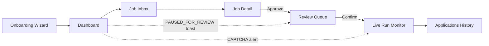
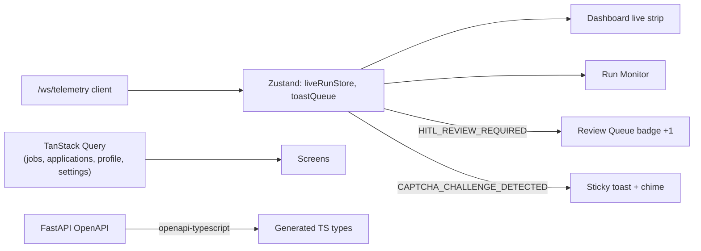

# JobSeeker — Frontend Technical Design (Next.js in Tauri 2)

**Document Version:** 2.2.0 (Tauri 2 desktop revision)
**Owner:** OpenCode (frontend implementer + integration lead)
**Scope:** The dashboard ("command center") of JobSeeker — screen inventory, routes, wireframes, state architecture, API/WebSocket bindings, and Tauri desktop integration. In v2.2 this dashboard is the **sole interface** and it ships **inside the Tauri 2 desktop app** as a Next.js **static export**. There is no browser extension. The automation browser remains a separate visible Chrome window the dashboard monitors.
**Consumes:** the frozen contract in `docs/BACKEND_IMPLEMENTATION_SPEC.md` §7–8. Never invent endpoints.
**Packaging:** `docs/DESKTOP_PACKAGING_SPEC.md` (shell topology, sidecar handshake, security, installer, QA). Where this doc and that spec disagree on shell behavior, **the packaging spec wins**.

**Design principle:** the dashboard is a **decision cockpit, not a wall of tables.** The user's real job is triage (approve/skip/tune) and oversight (what did the bot do, what will it do next). Every screen optimizes for one decision per glance.

---

## 0. What changed in v2.2

| Change | Reason |
| :--- | :--- |
| **The dashboard ships inside a Tauri 2 desktop shell; Next.js builds with `output: 'export'`.** | The product is a desktop app; the shell owns the window, tray, updater, and lifecycle, and loads `frontend/out`. No Node runtime reaches the user. |
| **Detail routes are query-based: `/jobs?id=<uuid>` and `/runs?id=<uuid>`.** | Static export cannot generate runtime UUID paths. Decided at F0 so nothing has to be refactored later. Pages using `useSearchParams()` are wrapped in `<Suspense>`. |
| **API base + token come from the shell via `get_bootstrap()`, not a build-time env var.** | The sidecar's port and per-launch token are only known at runtime; the client is origin-agnostic (`apiBase` injected) and never persists the token. |
| **Native integration surface added** (notifications, dialogs, opener, updater, window-state, tray). | A desktop shell is more than a wrapper: HITL needs a real notification, artifacts need a real save dialog. |
| **Desktop UX states added** (splash/starting, backend unavailable, offline, update available, About, first run). | Production-grade desktop means the failure and first-run paths are designed, not accidental. |
| **Desktop quality gates + Phase D references added.** | The frontend track now has desktop acceptance criteria alongside F0–F4. |

*Prior revisions:* v2.1 moved the SPA to Next.js App Router and pinned client/data conventions (the API wrapper, query keys, WS lifecycle, and MSW policy below are unchanged). v2.1's "runs as its own `next start` process on `:3000`" is superseded by the static-export model in §1.1.

---

## 1. Stack decision

| Layer | Choice | Rationale |
| :--- | :--- | :--- |
| Framework | **Next.js (latest stable, App Router) + React 19 + TypeScript** | File-based routing, nested layouts, route-level code splitting; typed contracts against FastAPI's OpenAPI |
| Styling | **Tailwind CSS + shadcn/ui + lucide-react** | Dark-mode-first palette; accessible primitives, owned in-repo (no opaque component library) |
| Data fetching | **TanStack Query v5** | Server-state caching, retries, optimistic updates for triage actions only |
| Client state | **Zustand** | Small stores only: `liveRunStore`, `toastStore`, `wsStatus` |
| Realtime | **Native WebSocket client** → Zustand live-run store → toasts/banners/steppers | Consumes `/ws/telemetry` events defined in `ARCHITECTURE_PLAN.md` §6.2 verbatim |
| Charts | **Recharts** | Funnel + daily-cap meters; no heavier lib needed |
| PDF preview | **react-pdf (pdf.js)** | Inline resume/cover-letter preview; client-only inside a `'use client'` component with a `next/dynamic` import; pdf.js worker bundled from `node_modules` (no CDN) |
| Routing | **App Router, static export** | Route map in §2; detail views use query params |
| Types | **`openapi-typescript`** from `docs/contract/openapi-M{n}.json` | Zero contract drift; generated files are committed |
| Desktop shell | **Tauri 2** (`@tauri-apps/api` + official plugins) | Bootstrap/token, notifications, dialogs/fs, opener, updater, window-state, tray. Details in `docs/DESKTOP_PACKAGING_SPEC.md` |
| Dev mocking | **MSW** (dev only, never in production build) | Lets the frontend progress while backend milestones land |

### 1.1 Runtime and serving model (decided)

The shipped app is **three processes on one machine**, all local:

```
JobSeeker.exe (Tauri 2 shell)       native window (WebView2)      ← the UI host
  └─ loads frontend/out          http://tauri.localhost
autojob-core.exe (Python sidecar) 127.0.0.1:<os-assigned port>  ← REST + WS only
Chrome (Playwright)              separate visible window        ← automation
```

The shell and its `"tauri://localhost"` / `http://tauri.localhost` origins are **distinct from** the sidecar origin, so the API is cross-origin by design and carries a per-launch bearer token.

| Mode | UI origin | API base | Auth |
| :--- | :--- | :--- | :--- |
| **Desktop (shipped)** | `http://tauri.localhost` (static export) | `http://127.0.0.1:<port>/api/v1` from `get_bootstrap()` | `Authorization: Bearer <token>` |
| **Web dev** | `http://127.0.0.1:3000` (`next dev`) | `NEXT_PUBLIC_API_BASE` → `http://127.0.0.1:8000/api/v1` | none (localhost dev) |

- **`next.config.ts`:** `output: 'export'`, `trailingSlash: true`, `images.unoptimized: true`. Tauri `build.frontendDist` points at `frontend/out`.
- **API base + token are runtime values** from the shell bootstrap, not build-time env vars (the port is assigned at launch). `NEXT_PUBLIC_API_BASE` is a dev-only fallback.
- **WS:** `ws://127.0.0.1:<port>/ws/telemetry?token=<token>` — direct to the sidecar; no Next.js rewrites (they don't exist in a static export anyway).
- **Backend CORS allowlist:** `http://tauri.localhost`, `https://tauri.localhost`, `tauri://localhost`, plus dev origins `http://localhost:3000`, `http://127.0.0.1:3000`. The backend also enforces a strict `Host` check (`127.0.0.1:<port>` / `localhost:<port>`).
- Dev: `npm run dev` (Turbopack) · Static build: `npm run build` → `frontend/out`.
- Root launchers: `scripts/dev.ps1` (web dev) · `scripts/package.ps1` (sidecar + `tauri build`).
- Fonts: self-hosted via `next/font/local`; **no runtime Google Fonts call** (offline-capable, CSP-friendly).

**Why `output: 'export'`:** the desktop shell must load the UI without a Node process. Export's only constraint is no runtime dynamic segments — solved by query-parameter detail routes (§2). Everything else (layouts, client components, code splitting) is intact.

### 1.1.1 Bootstrap and API client wiring

On first render the client calls the shell's `get_bootstrap()` Tauri command → `{ apiBase, wsBase, token, version, platform }`. Until it resolves, the app renders a **skeleton**, never an error. The token is held **in memory only** (module scope) — never `localStorage`, never a cookie, never logged. In web-dev mode the bootstrap shim returns the `NEXT_PUBLIC_*` values with no token.

### 1.2 Project structure

```
frontend/
├── app/
│   ├── layout.tsx                      # root: fonts, providers, theme, Suspense boundary
│   ├── page.tsx                        # boot gate: /profile → /dashboard or /onboarding
│   ├── globals.css
│   ├── (onboarding)/onboarding/page.tsx
│   └── (dashboard)/
│       ├── layout.tsx                  # shell: nav, WS provider, toasts, browser banner
│       ├── dashboard/page.tsx
│       ├── jobs/page.tsx               # list; detail via ?id=<uuid> (same route, Suspense)
│       ├── review/page.tsx
│       ├── applications/page.tsx
│       ├── runs/page.tsx               # monitor; ?id=<uuid>
│       ├── profile/page.tsx
│       ├── profile/qa/page.tsx
│       ├── settings/page.tsx
│       └── settings/browser/page.tsx
├── components/
│   ├── ui/                             # shadcn primitives
│   ├── shell/                          # nav, cap meters, browser banner, toasts, splash/error states
│   ├── jobs/                           # score chip, breakdown bars, skill badges, job-detail drawer
│   ├── runs/                           # stepper, event log, captcha banner
│   ├── profile/                        # bullet pool, metric chips, qa editor
│   └── settings/                       # risk cards, opt-in dialogs, budget gauge
├── lib/
│   ├── api/client.ts                   # fetch wrapper, error envelope, typed helpers
│   ├── api/bootstrap.ts                # get_bootstrap() bridge + web-dev shim
│   ├── api/generated/                  # openapi-typescript output (generated)
│   ├── api/queries.ts                  # query keys + hooks
│   ├── ws/client.ts                    # reconnect, RESYNC, ring buffer
│   ├── desktop/                        # notifications, dialogs/save, opener, updater, window-state
│   ├── format.ts                       # dates, salary, durations
│   └── env.ts                          # validated NEXT_PUBLIC_* access (dev)
├── stores/                             # liveRunStore.ts, toastStore.ts
├── hooks/                              # useKeyboardTriage, useCapMeters, useProfileGate
├── tests/                              # Playwright E2E + MSW handlers
├── public/
├── next.config.ts
├── tailwind.config.ts
├── tsconfig.json
├── package.json
└── .env.example
```

---

## 2. Route map (App Router)

| Route | File | Primary data | Purpose |
| :--- | :--- | :--- | :--- |
| `/` | `app/page.tsx` | `GET /profile` | Boot gate → `/onboarding` if 404, else `/dashboard` |
| `/onboarding` | `app/(onboarding)/onboarding/page.tsx` | profile import/confirm, settings | 4-step first-run wizard |
| `/dashboard` | `app/(dashboard)/dashboard/page.tsx` | jobs, applications, settings, `/health` | Pipeline counts, caps, live run strip, browser banner |
| `/jobs` | `.../jobs/page.tsx` | `GET /jobs` | Triage inbox |
| `/jobs?id=<uuid>` | `.../jobs/page.tsx` (Suspense) | `GET /jobs/{id}`, matcher routes | JD, score breakdown, artifacts |
| `/review` | `.../review/page.tsx` | `GET /applications?status=PAUSED_FOR_REVIEW`, `GET /jobs?min_score=65` | HITL queue |
| `/applications` | `.../applications/page.tsx` | `GET /applications` | History + Q&A audit |
| `/runs?id=<uuid>` | `.../runs/page.tsx` (Suspense) | `GET /applications/{id}` + WS | Live run monitor |
| `/profile` | `.../profile/page.tsx` | `GET/POST /profile` | Master profile + bullet pool |
| `/profile/qa` | `.../profile/qa/page.tsx` | `GET/POST /profile/qa` | QA knowledge base |
| `/settings` | `.../settings/page.tsx` | `GET/POST /settings` | Caps, hours, mode, risk opt-ins, LLM |
| `/settings/browser` | `.../settings/browser/page.tsx` | `GET /browser/status`, launch/close | Automation browser + login wizard |

**Static-export routing rules (non-negotiable):**

- Dynamic UUID segments are **not** used. Detail screens read their id from `useSearchParams()` (`?id=<uuid>`); the list route is the same file, so `/jobs` and `/jobs?id=…` share one statically-exported page.
- Any component calling `useSearchParams()` is wrapped in `<Suspense>` (the boundary lives in the route/layout), otherwise the export build fails.
- Client-side navigation via `next/link` / `router.push` with query strings works normally (no full reload).
- Deep-link/refresh on `/jobs?id=…` resolves locally: the shell serves `jobs/index.html` and the query string is preserved (`trailingSlash: true`).



All interactive screens are client components (`'use client'`). No business logic runs in a Next.js route handler — the backend owns it, and in a static export there are no route handlers anyway.

---

## 3. Screen specifications

### 3.1 Onboarding Wizard (`/onboarding`) — 4 steps

1. **Import** — upload a PDF/DOCX → `POST /api/v1/profile/import-resume` (multipart) returns `{draft_id, draft}`. Banner: *"AI import is a draft — every bullet below becomes a factual claim on your resumes. Review each one."* Every imported item shows `unverified` until confirmed.
2. **Facts** — contact, work authorization, sponsorship, salary floor, notice period, links. Autocomplete from the draft; nothing silently trusted.
3. **Preferences** — target titles, locations, remote policy, excluded companies, daily caps.
4. **Sources** — pick discovery sources; LinkedIn/easy-apply toggles render the ToS risk card (§3.9) and stay OFF by default.

Finish → `POST /api/v1/profile/import-resume/confirm` with accepted IDs/edits → `POST /api/v1/profile` for the manual fields → invalidate profile queries → redirect to `/dashboard`.

### 3.2 Dashboard (`/dashboard`)

```
┌────────────────────────────────────────────────────────────────────────┐
│ JobSeeker        [Dashboard][Jobs][Review (3)][Applications][Settings]  │
├──────────────┬──────────────┬──────────────┬───────────────────────────┤
│ New jobs     │ Awaiting     │ Staged for   │ Applied today             │
│    47        │ your review  │ submission   │ 7 / 20  ▓▓▓▓░░░░  caps OK │
│  (today)     │      3       │      5       │ LinkedIn 2/25 · ATS 5/40  │
├──────────────┴──────────────┴──────────────┴───────────────────────────┤
│ LIVE RUN — Stripe / Senior Backend Engineer                             │
│ NAVIGATING → FILLING_FIELDS → UPLOADING_RESUME → [ANSWERING_QA] →      │
│ PAUSED_FOR_REVIEW → SUBMITTED        ⏱ 2m14s   [Open monitor]           │
├─────────────────────────────────────────────────────────────────────────┤
│ Match funnel (7d): 312 discovered → 96 scored → 41 ≥80% → 18 tailored   │
│ → 12 submitted → 3 recruiter replies                                    │
├─────────────────────────────────────────────────────────────────────────┤
│ ⚠ Browser runtime: automation Chrome not running   [Launch] [Settings]  │
└─────────────────────────────────────────────────────────────────────────┘
```

- Live strip + toasts driven by `/ws/telemetry` (`APPLICATION_STAGE_CHANGED`, `RATE_LIMIT_UPDATE`, `CAPTCHA_CHALLENGE_DETECTED`, `HITL_REVIEW_REQUIRED`).
- Cap meters turn amber at 80% of any daily cap and red at 100% (hard stop; queue pauses).
- Browser-runtime banner polls `GET /browser/status` every 15 s and offers one-click launch.
- Funnel count for "recruiter replies" is display-only until the backend exposes it; until then the last segment renders as a dash, never a fabricated number.

### 3.3 Job Inbox (`/jobs`) — the triage workhorse

- **Row:** company · title · location/remote · source badge (`Greenhouse` `Lever` `LinkedIn`...) · match score chip (≥80 green, 65–79 amber, <65 gray, gate-fail red slash) · salary (if known) · age.
- **Filters:** status, score band, source, remote type, salary floor, "new since last visit". **Sort:** score, freshness. URL-synced so a view can be bookmarked.
- **Bulk actions:** skip, stage for tailoring, archive (optimistic; rollback on error).
- **Keyboard-first:** `j/k` navigate, `s` skip, `Enter` open, `x` select, `Shift+A` select-all-visible.

### 3.4 Job Detail (`/jobs?id=<uuid>`)

Three panes, tabbed on narrow screens:

1. **Job** — sanitized JD (rendered as text/markdown, never raw HTML) + extracted requirements from `GET /api/v1/jobs/{id}` with *matched / missing* badges per skill.
2. **Score breakdown** — hard-gate status and `S_req / S_pref / S_vec / S_llm / S_exp` weighted bars → final score. Missing-requirement chips explain *why*. When `degraded = true` (no LLM key/budget), show a visible "local-only scoring" note instead of pretending the LLM component ran.
3. **Tailored artifacts** — side-by-side PDF preview (tailored vs master) with added/removed bullet diff highlighting, cover-letter text (editable inline before staging), fact-check badge (`PASSED / FAILED / WARNING`). Buttons: `Tailor now`, `Stage for submission`, `Skip with reason`.

Artifacts are fetched via `GET /api/v1/matcher/resume/{job_id}` and `GET /api/v1/matcher/cover-letter/{job_id}?format=txt|pdf`. `tailored: null` renders an empty state, not an error.

### 3.5 Review Queue (`/review`) — HITL heart

One card per pending item (score 65–79 queue or a run paused at `PAUSED_FOR_REVIEW`):

- Every Q&A answer that will be submitted, with provenance badge: `DETERMINISTIC` (blue, confidence n%) · `LLM_GENERATED` (amber — expanded, editable) · `UNRESOLVED` (red — blocks submission until answered).
- Artifact attachments (file names + inline preview).
- Company-cooldown and daily-cap status for this submission.
- Actions: `Approve & submit` (primary), `Edit answers`, `Discard`. Editing writes back to the QA bank (`POST /api/v1/profile/qa`) so the same question is never re-asked.
- **Where the final click happens:** in Assisted mode the run pauses at the *real* final review screen in the visible automation browser — the user can click Submit there (primary path), or use `Approve & submit` here, which makes the backend click it (`POST /applications/approve/{id}`). Both paths are audited identically.

### 3.6 Live Run Monitor (`/runs?id=<uuid>`)

- Stage stepper mirroring the WS contract exactly (`NAVIGATING → FILLING_FIELDS → UPLOADING_RESUME → ANSWERING_QA → PAUSED_FOR_REVIEW → SUBMITTED/FAILED`), elapsed time, current-step/total-steps.
- **CAPTCHA state:** full-width red banner — *"Security check on Stripe — solve it in the automation Chrome window. Auto-abort in 4:37."* with the 5-minute AFK countdown and `Keep waiting` / `Abort` actions.
- Scrollable event log (every stage change, field filled, answer resolved) + screenshot thumbnail once captured.
- On mount, hydrate from `GET /applications/{id}` (events + `qa_answers`), then apply WS deltas.
- If the WS drops, show a "telemetry offline — reconnecting" pill and fall back to polling every 5 s until `RESYNC` succeeds.

### 3.7 Applications History (`/applications`)

Table: date, company, title, platform, mode (`ASSISTED` / `AUTONOMOUS`), status chip, duration, receipt link, screenshot link. Row expands into the full `qa_answers_audit` trail (question, answer, tier, confidence, `user_verified`). Filters by status/platform/date; CSV export (M6 endpoint; hide the button until it exists). This screen is the user's accountability record — treat it as first-class.

### 3.8 Profile & QA editors (`/profile`, `/profile/qa`)

- **Bullet-pool editor:** experiences → bullets grid, each with skills-used chips, metrics list (rendered as **locked chips** — numbers are immutable constants), domain tags, priority. Drag to reorder. "Verify" toggle drives the fact-checker's trust set.
- **QA bank:** canonical question, patterns (regex), answer, category, source (`USER_VERIFIED` vs `LLM_CACHED`), confidence; low-confidence LLM-cached entries surface with a "review me" badge.
- Both editors save via debounced `POST` and show a per-item save state; a failed save never silently discards the edit.

### 3.9 Settings (`/settings`)

- **Automation:** mode (Assisted default / Autonomous-gated with the ≥95% + 100%-deterministic prerequisites listed inline), daily caps per platform, working-hours window, company cooldown days.
- **Platform opt-ins:** each platform card states its risk profile factually: *Greenhouse/Lever/Ashby — public application forms, no automation ToS conflict. LinkedIn Easy Apply — automation violates LinkedIn's User Agreement regardless of stealth; account restriction is possible; enable at your own risk.* LinkedIn stays OFF until the typed acknowledgment (`I UNDERSTAND THE RISK`) is submitted to `POST /settings/platform-optin`.
- **LLM:** provider keys (posted once to `POST /settings/llm-key`, never displayed again), model routing, monthly budget gauge.
- **Browser runtime** (`/settings/browser`): launch/close via `POST /browser/launch` / `/browser/close`, status via `GET /browser/status`, per-platform login state, "profile last active" indicator, guided login wizard (opens the platform in the automation window; JobSeeker never sees credentials).

---

## 4. Design system (tokens)

| Token | Value | Use |
| :--- | :--- | :--- |
| `--bg / --surface` | `#0b0f14 / #111820` | Dark-first |
| `--accent` | `#4f8cff` | Primary actions, links |
| Score ≥80 | `#22c55e` chip | auto-stage band |
| Score 65–79 | `#f59e0b` chip | HITL band |
| Gate-fail / error | `#ef4444` chip + slash icon | hard-gate disqualification |
| `DETERMINISTIC` badge | blue outline | Q&A provenance |
| `LLM_GENERATED` badge | amber outline | Q&A provenance — invites scrutiny |
| `UNRESOLVED` badge | red filled | blocks submission |

**Status chips:** exactly one token per canonical `Application.status` value — `QUEUED`, `STARTING`, `AUTOFILLING`, `PAUSED_FOR_REVIEW`, `SUBMITTED`, `FAILED`, `BLOCKED`, `CAPTCHA_BLOCKED`, `DISCARDED`. There is no `IN_PROGRESS`.

Rules: no action is ever more than one click from its context (approve lives on the card it approves); destructive actions (`Discard application`) require confirmation; every automated action displays its provenance. Numbers on cap meters are the single source of truth for "can I still apply today."

---

## 5. State, data, and realtime architecture



### 5.1 API client

- `lib/api/client.ts` is the only place that calls `fetch`.
- It takes `apiBase` + `token` from the resolved **bootstrap** (§1.1.1), sets JSON headers, attaches `Authorization: Bearer <token>` on every `/api/v1/*` request, parses the frozen error envelope `{error: {code, message, details}}` into a typed `ApiError`, and maps HTTP status → UI treatment.
- In web-dev mode the bootstrap shim supplies `NEXT_PUBLIC_API_BASE` and no token.
- A `401` means the token was rejected (e.g., the sidecar restarted); the client surfaces the "Backend disconnected — reconnecting" state and re-fetches bootstrap rather than retrying blindly. A `403` from the Host/CORS guard is treated as a hard configuration error, never silently retried.
- Special cases: `503 llm_not_configured` → "Add an LLM key in Settings"; `503 budget_exceeded` → "Monthly budget reached"; `409 browser_not_running` → open the browser banner; `403 linkedin_not_opted_in` → risk card.
- No component ever hardcodes a URL string, and the token is never rendered or logged.

### 5.2 Query keys and invalidation

| Key | Endpoint | Invalidated by |
| :--- | :--- | :--- |
| `['profile']` | `GET /profile` | profile save, import confirm |
| `['profile','qa']` | `GET /profile/qa` | QA save, review-queue edit |
| `['jobs', filters]` | `GET /jobs` | crawl complete (`SWEEP_COMPLETED`), triage action |
| `['job', id]` | `GET /jobs/{id}` | tailor, triage |
| `['applications', filters]` | `GET /applications` | stage events, approve, abort |
| `['application', id]` | `GET /applications/{id}` | stage events |
| `['settings']` | `GET /settings` | settings save, caps events |
| `['browser']` | `GET /browser/status` | poll 15 s + launch/close |
| `['health']` | `GET /health` | poll 30 s |

Optimistic updates are allowed **only** for triage actions (skip/stage/archive). Approvals, submits, and profile verification are never optimistic — they gate real outcomes.

### 5.3 WebSocket lifecycle

- One connection, opened in `app/(dashboard)/layout.tsx`; closed on unmount.
- Reconnect with exponential backoff (1 s → 30 s, jitter); status exposed via `wsStatus`.
- On reconnect: send `{"type":"RESYNC"}` and refetch `['applications']` + `['jobs']` to heal missed events.
- Events mutate `liveRunStore` and invalidate the matching query key. Event names and payload fields are consumed exactly as frozen — no frontend aliases.
- `SWEEP_COMPLETED` → toast with new/duplicate/filtered counts + invalidate jobs.

### 5.4 MSW policy

- Dev-only handlers generated from `docs/contract/examples/*.json`.
- Enabled by `NEXT_PUBLIC_USE_MOCKS=1`; the production build fails if the flag is on.
- A screen is not accepted until it renders **live** backend data. Mocks are scaffolding, not deliverables.

### 5.5 PDF and chart rendering

`react-pdf` and Recharts are client-only: import via `next/dynamic` inside a `'use client'` component (static export has no server runtime), render a skeleton while loading, and configure the `pdfjs-dist` worker from `node_modules` (bundled, no CDN) so the app stays offline-capable.

### 5.6 Native integration surface (Tauri)

All native calls live behind `lib/desktop/*` and degrade gracefully in web-dev mode (no-op or browser fallback). Capabilities are least-privilege (`DESKTOP_PACKAGING_SPEC.md` §6.3).

| Capability | Plugin / API | Used for |
| :--- | :--- | :--- |
| Bootstrap | Tauri `invoke('get_bootstrap')` | `apiBase`, `wsBase`, `token`, versions |
| Notifications | `@tauri-apps/plugin-notification` | HITL review required, CAPTCHA alert, update ready |
| Chime | bundled `chime.ogg` via `<audio>` | HITL/CAPTCHA chime (respects the mute setting) |
| Save artifact | `@tauri-apps/plugin-dialog` + `plugin-fs` | Save resume/cover PDF, export diagnostics |
| Open externally | `@tauri-apps/plugin-opener` | Job posting links, data/log folders — **`http:`/`https:` allowlist, user-click only** |
| Window state | `@tauri-apps/plugin-window-state` | Remember size/position/maximized |
| Updater | `@tauri-apps/plugin-updater` + `plugin-process` | Check, download, verify, relaunch |
| Autostart | `@tauri-apps/plugin-autostart` | Optional, off by default |

**Rules:** never auto-open a scraped URL; only after an explicit click and only `http`/`https`. Downloads go through the dialog/fs plugins, never `window.open`. Notification permission is requested lazily on the first HITL event, not at boot.

### 5.7 Desktop UX states

| State | UI |
| :--- | :--- |
| **Starting** | Branded splash while the sidecar boots ("Starting JobSeeker… This can take a few seconds on first launch."). No white flash; the window stays hidden until bootstrap succeeds. |
| **Backend unavailable** | Full-screen error with **Retry**, **Open logs**, **Export diagnostics**. Never a blank window. |
| **Reconnecting** | Top banner "Backend disconnected — reconnecting…"; queries retry with backoff; local screens stay usable. |
| **Offline** | Banner; crawling and LLM actions pause; triage/read screens keep working from cached query data. |
| **Update available** | Non-blocking banner → release notes → download progress → "Restart to update". Deferred while a run is active. |
| **First run** | WebView2/Chrome availability, data folder, LLM key checks; blocks only what is truly required. |
| **About** | App version, contract version, sidecar version, data folder, log folder, update channel, signature status. |

### 5.8 Frontend security rules

- Render job descriptions as **text/markdown**, never raw HTML, never `dangerouslySetInnerHTML` on scraped content.
- No remote fonts, scripts, images, or iframes; self-host everything.
- No `eval`, no `new Function`.
- Never render the bearer token or absolute machine paths in the DOM.
- CSP is set by the shell (`DESKTOP_PACKAGING_SPEC.md` §6.2); the UI must not require anything the CSP forbids.

---

## 6. Frontend milestones (F0–F4 + desktop D0–D3)

| Milestone | Week | Scope | Acceptance |
| :--- | :--- | :--- | :--- |
| **F0** | 0 | Scaffold, tokens, shell, bootstrap + API client, WS client, MSW, route stubs, static-export config | `npm run build` produces `out/`; `/dashboard` renders `/health` from the live backend |
| **F1** | 1–2 | Onboarding wizard, Job Inbox, Job Detail (JD + requirements), Dashboard v1 | Crawl → jobs appear; triage skip/stage works on live data; keyboard path verified |
| **F2** | 3 | Score-breakdown tab, PDF preview + master/tailored diff, Profile + QA editors, Applications history v1 | Score components render including degraded mode; PDFs load offline; verified-toggle persists |
| **F3** | 4 | Review Queue (provenance + edit), Run Monitor, WS live strip + toasts, Settings automation, Browser screen | Gate G2: full Assisted run visible end-to-end with live stage events and CAPTCHA banner |
| **F4** | 5–8 | Risk opt-in + autonomous gating UI, analytics + CSV, empty/loading/error states, a11y, Playwright E2E | Every screen accepted on live API; E2E green; no mocked fields remain |

**Desktop track** (runs alongside; see `DESKTOP_PACKAGING_SPEC.md` §16 for the authoritative definitions):

| Milestone | Week | Frontend scope | Acceptance |
| :--- | :--- | :--- | :--- |
| **D0** | 0–1 | Static export loads in the shell; bootstrap shim; splash + backend-unavailable states; window-state | Window opens, UI renders, talks to a stub sidecar over token auth |
| **D1** | 5–6 | Real sidecar wiring (port/token), reconnect banner, notifications, dialogs/save, opener, error boundaries | Packaged app completes a full Assisted run on the mock ATS |
| **D2** | 7–8 | Updater banner + About screen, first-run checks, offline state, diagnostics export | Installer + updater produced by CI; UI surfaces update/rollback correctly |
| **D3** | 9 | Desktop QA pass: DPI, a11y, performance, empty/error polish | QA matrix green on a clean Windows VM |

**Dependency rule:** F1 needs backend M1 (jobs + profile). F2 needs M2 (score breakdown) and M3 (artifacts). F3 needs M4 (applications + WS). F4 needs M5/M6. D0 can start at Week 0 with a stub sidecar (de-risks the hardest integration early). If a dependency slips, build against the frozen contract + MSW and finish on integration day.

---

## 7. Quality gates

A screen is "done" only when all of these hold:

1. `npm run typecheck` and `npm run lint` pass with zero `any` in app code.
2. `npm run build` produces a clean **static export** (`out/`) with no `NEXT_PUBLIC_USE_MOCKS`; no route depends on a Node runtime.
3. Loading, empty, error, and 403/409/503 states are implemented — not just the happy path.
4. Keyboard path works for every triage/approval action; focus is visible; dialogs trap focus.
5. Screen renders real API data with zero mocked fields.
6. WS-driven state is verified against recorded event fixtures.
7. One Playwright happy-path per screen against the seeded DB.
8. No layout shift on first paint; skeletons for every async region.
9. No secret, token, or absolute machine path is rendered to the DOM.
10. Every destructive action confirms; every automated action shows provenance.
11. **Desktop gate:** the screen works inside the Tauri window with the shell bootstrap (no `NEXT_PUBLIC_*` API base), and the "backend unavailable" / "reconnecting" states render correctly when the sidecar is stopped.
12. **Desktop gate:** `useSearchParams()` pages are wrapped in `<Suspense>`; refresh on `/jobs?id=…` and `/runs?id=…` resolves offline.
13. **Desktop gate:** no CSP violation in the release WebView2 console; no remote asset requests.

---

## 8. Explicitly deferred

Mobile/responsive layouts beyond 1280 px, multi-profile/multi-user support, i18n, light-theme parity (dark-first only), a custom titlebar, multi-window, and any server-side business logic. None block v1 value.